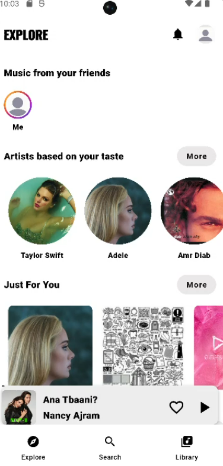
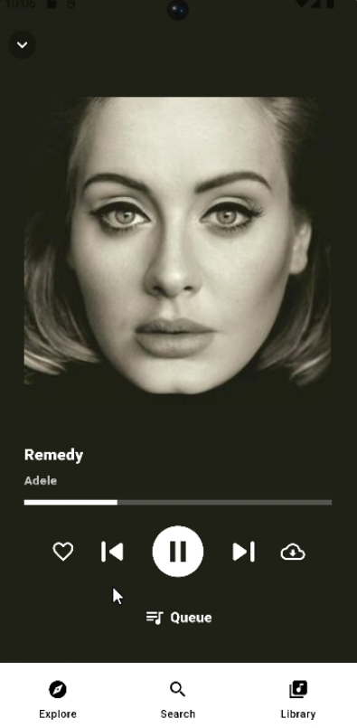
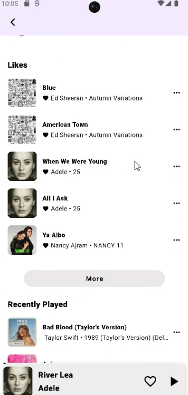

<div align="center">

# 🎵 Music Streaming App

### Flutter Frontend · Full-Stack Academic Project

A music streaming mobile application built with **Flutter and Dart**, featuring an interactive music player, personalized music library, and integration with a **C#/.NET backend**.


**[Backend Repository](https://github.com/janassaadeh/mymusic-app-live)** · **[Demo Video](#-demo)** · **[Screenshots](#-screenshots)**

</div>

---

## ✨ Overview

This project recreates key features of a modern music streaming experience in a Flutter mobile app. Users can explore music, browse their library, interact with songs and artists, and control playback through a dedicated full-screen player.

The Flutter frontend is designed to work with a separate **ASP.NET/.NET backend**, which provides APIs for music content and user interactions.

> **Project type:** Master's academic project / portfolio demonstration. This is an independently developed learning project and is not affiliated with Anghami or other music streaming services.

## 📱 Features

### 🎧 Music player
- Full-screen now-playing interface with album artwork
- Play/pause and previous/next track controls
- Playback progress display
- Like/unlike control from the player
- Album-themed player backgrounds
- Compact mini-player for easy access while browsing

### 📚 Your music library
- Browse playlists, albums, and artists
- View liked songs and recently played music
- Create and browse playlists
- Access followed artists

### 🔎 Music discovery and navigation
- Explore, Search, and Library navigation tabs
- Browse music-related content and artist information

### 🔗 Backend integration
The mobile application connects to a separate C#/.NET backend designed to support:
- Song playback and playback history
- Liking and unliking songs
- Following and unfollowing artists and playlists
- Retrieving liked and recently played songs
- Music catalog data

> The backend capabilities are documented in its own repository. Specific frontend API coverage depends on the Flutter implementation.

## 🛠️ Tech stack

| Area | Technology |
| --- | --- |
| Mobile app | Flutter, Dart |
| Target shown in demo | Android |
| Backend | C# / .NET, ASP.NET |
| Data layer (backend) | SQL Server, Entity Framework Core, ADO.NET |
| Client–server communication | REST APIs |

**Backend source:** [Music App Backend](https://github.com/janassaadeh/mymusic-app-live)

## 🎬 Demo

Watch the Flutter app in action: **[Add your demo video URL here](YOUR_DEMO_VIDEO_URL)**

The demo showcases the library, full-screen music player, playback controls, changing album artwork and themed backgrounds, and artist/liked-song views.

*Replace `YOUR_DEMO_VIDEO_URL` with a GitHub-hosted video, YouTube link, or Google Drive share link before publishing.*

## 🖼️ Screenshots

| Music Library | Now Playing | Artists & Likes |
|:---:|:---:|:---:|
|  |  |  |

## 🚀 Getting started

### Prerequisites
- Flutter SDK installed
- Android Studio or VS Code with Flutter/Dart extensions
- Android emulator or physical Android device
- Access to the corresponding backend for API-powered features

### Run the Flutter app

```bash
git clone YOUR_FLUTTER_REPOSITORY_URL
cd YOUR_FLUTTER_REPOSITORY_FOLDER
flutter pub get
flutter run
```

> Configure the application's backend base URL using the location and method defined in the Flutter source code. The backend may need to be running locally or hosted for API-backed screens to work. Replace the repository URL and directory above with your actual values.

## 🧩 How the pieces fit together

```text
Flutter Mobile App
        |
        | REST API requests
        v
 C# / ASP.NET Backend
        |
        +-- Controllers
        +-- Services
        +-- Repositories
        |
        v
    SQL Server
```

The backend uses Entity Framework Core for common CRUD operations and ADO.NET for selected playback and user-interaction operations. See the [backend repository](https://github.com/janassaadeh/mymusic-app-live) for details.

## 📌 Project scope

This project was built to practice **Flutter mobile development**, **frontend–backend integration**, and the implementation of interactive music-app features. It is an academic/portfolio project rather than a commercial streaming platform.

---

<div align="center">

Made with Flutter · [View the backend](https://github.com/janassaadeh/mymusic-app-live)

</div>
